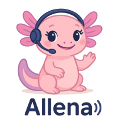

  

# Allena

A Allena é uma extensão para Chrome baseada em IA desenvolvida para a competição Inovathon WTM 2025. A equipe SheCodes formada por Amanda Gontijo, Ellen Morgana e Laissa Soares conquistou o 1º Lugar!

## 📌 Objetivo
* Tornar a web mais acessível a pessoas com deficiência sem depender do HTML dos sites;
* Permitir fluxo de navegação pelos sites mais rápido em comparação ao uso com leitores de tela;
* Permitir o controle por comandos de voz e executar ações básicas como:
  * Clicar em Botões
  * Resumir o conteúdo do site (a ser desenvolvido)
  * Digitar texto (a ser desenvolvido)

## 🛠️ Construído com
* Javascript
* Python
* Flask
* Gemini API

## ⚙️ Resultados
* A Allena apresenta uma eficiência incrível se comparado aos leitores de tela:
  

https://github.com/user-attachments/assets/c4a365ae-55bb-4769-91d7-7257c4389bf4

https://github.com/user-attachments/assets/ef403b57-cb6e-4aa5-b5b7-3fc902be398d

* Melhorias futuras: implementar mais ações, lidar melhor com a permissão de microfone.
* Observação: O lançamento da Google I/O promete integrar o Gemini ao Chrome e assim, todas as ações perfomadas pela Allena, já estariam no escopo do Gemini. Por isso, o projeto não será evoluido, mas serviu como validação de uma ideia inovadora da nossa equipe!
